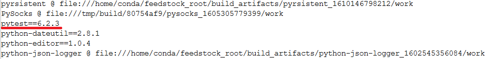

Installing Custom Packages on Coffea-Casa
=========
Coffea-casa provides support for users to install their own packages through pip. In cases where your notebook does not send jobs to workers, you can simply install your packages to the scheduler through the terminal. If you wish for your workers to make use of custom packages, however, you'll need to go through some extra steps to ensure your packages are installed on all workers. Installation to the scheduler is recommended in either case.

Installations on the Scheduler
-----
Let's run through an example: we want to install pytest to our scheduler, and we don't need it to be distributed across our workers. In that case, we can open up a new terminal in coffea-casa by going to the **File** tab and starting a new launcher. A cursory ``pip freeze`` demonstrates that pytest is *not* installed by default, and so we have to add it ourselves. We can do this through ``pip install pytest``, which will tell us that the package is being installed into ``/opt/conda/lib/python3.8/site-packages``. A follow-up ``pip freeze`` indicates that pytest is now in our list of packages:

   
More complicated pip installations are also available. Refer to the `pip install docs <https://pip.pypa.io/en/stable/cli/pip_install/>`_ for more information.

Installations on the Workers
-----
If you install a package to your scheduler but attempt to run it on your workers, you will quickly run into ``ModuleNotFound`` errors. This is because your workers don't have the package! Luckily, a remedy to this problem is fairly simple. Again, let's assume that we wish to install pytest and that this time we wish to use it during processing on our workers. We first get it onto our scheduler (as above), and then we tell our workers to install it:

.. code-block:: python

    from dask.distributed import Client, PipInstall

    dependencies = [
        "pytest",
    ]
    client = Client("tls://localhost:8786")
    client.register_worker_plugin(PipInstall(packages=dependencies))
    
To use this code for your own purposes, you merely have to put in your dependencies in the ``dependencies`` list. This should support all installation formats that pip does, and you can add multiple packages by expanding the list. For example, to install a second package from a GitHub repository, you could specify:

.. code-block:: python

    dependencies = [
        "pytest",
        "topcoffea@git+https://github.com/TopEFT/topcoffea.git",
    ]
    
and your workers should have both pytest and topcoffea installed onto them.

Updating the Worker Environment from ``environment.yaml`` / ``requirements.txt``
---------------------------------------------------------------------------------
If your home directory contains ``~/environment.yaml`` (or ``~/environment.yml``) or ``~/requirements.txt``, :class:`CoffeaCasaCluster` sends them with every worker job. Each worker then installs them into the image's base environment before it starts (``mamba env update`` and ``pip install -r``, respectively). This happens on every worker start, so keep these files short.

These files are ignored when your conda environment is shipped to the workers (see below), because the workers then run your environment instead of the image's.

Running Workers in Your Own Conda Environment
---------------------------------------------
The Dask scheduler runs in your notebook kernel, so workers must run the same software as the kernel. If you run your notebook in a conda environment of your own instead of the image's base environment, :class:`CoffeaCasaCluster` can ship that environment to the workers. It does this automatically (``ship_env="auto"``, the default).

When you create a cluster from a kernel running in a non-base conda environment:

1. The environment is packed with `conda-pack <https://conda.github.io/conda-pack/>`_ into ``~/.cache/coffea-casa/envs/``. Packing a large environment can take a few minutes. The tarball is reused for later clusters until you install, remove or upgrade a package in the environment.
2. Packages installed in editable mode (``pip install -e``) can't be packed by conda-pack. Instead, a wheel is built for each of them every time a cluster is created, so your latest source changes reach the workers.
3. The tarball and the wheels are transferred with every worker job. Each worker unpacks the environment into its scratch directory, installs the wheels, and starts ``dask-worker`` with the environment's Python.
4. Each worker also makes the environment available at the path it has in your notebook (for example ``~/.conda/envs/myenv``), so file paths into the environment that your code resolved in the notebook, such as a package's data files, work on the workers too.

To set up such an environment, create it with the packages you need, plus ``ipykernel``, ``conda-pack`` and ``coffea-casa``, and register it as a Jupyter kernel:

.. code-block:: bash

    mamba create -p ~/.conda/envs/myenv -c conda-forge python=3.12 ipykernel conda-pack coffea dask distributed
    mamba run -p ~/.conda/envs/myenv pip install coffea-casa
    mamba run -p ~/.conda/envs/myenv python -m ipykernel install --user --name myenv --display-name "Python (myenv)"

.. note::

    Create the environment in your home directory, as above with ``-p ~/.conda/envs/myenv``. ``mamba create -n myenv`` may put it in ``/usr/local/envs``, which is part of the container image and is lost when your server restarts. The **Python (myenv)** kernel is then still listed, but fails to start. ``mamba env list`` shows where each environment lives.

Then select the **Python (myenv)** kernel in your notebook and create the cluster as usual:

.. code-block:: python

    from coffea_casa import CoffeaCasaCluster
    from dask.distributed import Client

    cluster = CoffeaCasaCluster()
    cluster.scale(10)
    client = Client(cluster)

    # Workers need a few minutes to start: the environment is transferred
    # and unpacked first
    client.wait_for_workers(1, timeout=900)

    # Workers report the unpacked env, not the image's /usr/local
    client.run(lambda: __import__("sys").prefix)

The ``ship_env`` argument controls this behaviour:

``"auto"`` (default)
    Ship the kernel's environment if it is a conda environment other than the image's base environment.

``True``
    Always ship the kernel's environment. Fails if the kernel is not running in a conda environment.

``False``
    Never ship it. Workers run the image's environment, updated from ``~/environment.yaml`` / ``~/requirements.txt`` if present.

.. note::

    ``conda-pack`` must be installed in *your* environment, not only in the image's base environment. Without it, creating the cluster fails with an error that tells you to install it or to pass ``ship_env=False``.

.. note::

    The environment tarball is transferred to the workers without encryption. Don't keep credentials or other secrets inside your conda environment's directory.

Sending Local Code to Workers
-----------------------------
To make your own modules or packages (that are not installed with pip) importable on the workers, pass them to :class:`CoffeaCasaCluster` with ``ship_paths``:

.. code-block:: python

    cluster = CoffeaCasaCluster(ship_paths=["foo.py", "myanalysis"])

Each file or directory is transferred with every worker job, and the job directory is put on the workers' ``PYTHONPATH``. Code that you import in the notebook, such as ``import foo`` or ``from myanalysis.sub import mod``, then also imports on the workers. Relative paths are resolved against the notebook's current directory.

Some restrictions apply:

* Every entry must have a different base name, since all of them land in the same job directory.
* Names can't contain ``,`` and can't be one of the names the cluster uses itself: ``environment.yaml``, ``environment.yml``, ``requirements.txt``, ``condor_token`` and ``cc-editable-wheels``.

Unlike ``client.upload_file`` (below), ``ship_paths`` accepts directories, so a whole package with subpackages can be shipped without zipping it first.

Sending Files to Workers (Without Pip)
-----
If you have a file that you wish to import without pip, and you need to send it to your workers, then you can do so by initializing your client and providing it the following line:

.. code-block:: python

    client.upload_file('foo.py')

Where ``foo.py`` is replaced by the file you are attempting to import.
